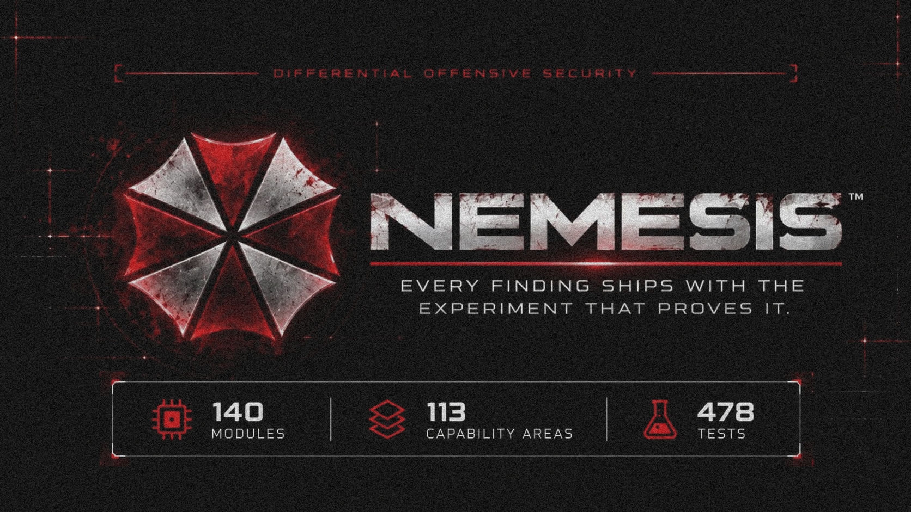

<p align="center">
  
</p>

<p align="center">
  
  
</p>

<p align="center">
  
  
  
  
  
</p>

<p align="center"><i>“Our business is life itself.”</i></p>

---

## The problem with scanners

Almost every scanner answers a question nobody asked: **“did a pattern match?”**

You get a list of template hits, a severity colour, and no way to tell the one real SQL
injection from the two hundred false positives. Then you spend the afternoon triaging —
which was the work the tool was supposed to do.

**nemesis answers a different question: *“did the server’s behaviour change when I
attacked it?”***

Every active check is a **differential experiment**. It sends a benign request, sends a
payload request to the *same* endpoint, and compares the two — status, body length,
timing, headers, and where the payload came back. A finding is only as strong as the
evidence that something changed.

That is why every active finding carries a **proof you can read**:

```
  CRITICAL  SQL injection in parameter 'q'
  target    http://127.0.0.1:8899/search
╭──────────────────────────────────────────────────────────────────────────╮
│ Baseline: 200 GET /search?q=x            (48B, 0.00s)                    │
│ Probe   : 500 GET /search?q=%27         (233B, 0.00s)                    │
│ Delta   : status +300, length +185 bytes (4.85x), time +0.00s            │
╰──────────────────────────────────────────────────────────────────────────╯
```

You do not have to trust the scanner. **You can read the experiment.**

---

## Install

```bash
git clone https://github.com/HexVandal/nemesis.git
cd nemesis
python -m venv .venv
.\.venv\Scripts\activate        # Windows
# source .venv/bin/activate     # Linux / macOS
pip install -e .
```

Python 3.10 or newer. Windows is a first-class target, not an afterthought.

## Run

```bash
nemesis scan https://example.com --profile quick
nemesis scan https://example.com --format html --output reports/
nemesis scan https://example.com -i injection -i auth --allow-destructive
nemesis scan --code-path ./src --profile code
```

Nine profiles: `quick`, `passive`, `web`, `code`, `recon`, `ai`, `blockchain`,
`forensics`, `full`. Five report formats: `console`, `json`, `markdown`, `html`,
`sarif`.

**Scope is default-deny.** Nothing outside the target host is touched unless you add a
rule with `--scope`. Exclusions always win. Modules that change state on the target are
marked destructive and never run unless you pass `--allow-destructive`.

---

## What it covers — 140 modules in 25 groups

| group | n | what it looks at |
|---|---:|---|
| injection | 18 | SQL, NoSQL, command, template, expression-language, XPath, LDAP, XXE, deserialisation, header and CRLF injection |
| auth | 15 | authentication bypass, JWT, session and CSRF defects, default and weak credentials, OAuth flows |
| code | 13 | source-level bugs: dangerous patterns, crypto misuse, IaC, git history, binary hardening, fuzz readiness |
| exposure | 12 | .git, CI config, `.env`, backups, debug consoles, actuator, directory listings, error pages |
| headers | 12 | security headers, cookie flags, CORS, CSP, clickjacking, mixed content, SRI, tabnabbing |
| ai | 9 | prompt injection (direct and indirect), system-prompt disclosure, model endpoints, agent tooling |
| api | 7 | unauthenticated access, function-level authz, OpenAPI, GraphQL introspection, depth abuse, enumeration |
| config | 7 | framework misconfiguration, default pages, HTTP methods, tech version disclosure |
| supplychain | 5 | lockfiles, SBOM, provenance, dependency confusion, typosquatting, licenses |
| host | 5 | DNS posture, subdomain takeover, dangling records, TLS configuration, IPv6 |
| disclosure | 5 | secrets in JS and storage, sensitive data in URLs, source maps, responses |
| logic | 4 | business logic, price tampering, coupon reuse, idempotency, pagination boundaries |
| deps | 4 | known-vulnerable dependencies via OSV, licence risk, manifest integrity |
| oauth | 4 | redirect bypass, PKCE, state, scope escalation |
| cache | 3 | web cache poisoning, deception, cache-control on authenticated responses |
| browser | 3 | client-side validation, storage of secrets, browser security posture |
| business | 2 | race conditions, workflow integrity |
| ssrf | 2 | server-side request forgery, redirect chains |
| traversal | 2 | path traversal, exposed file sweep |
| blockchain | 2 | Solidity patterns, DeFi surface |
| forensics | 2 | memory dump triage and analysis |
| smuggling | 1 | request smuggling |
| dos | 1 | unbounded request cost |
| upload | 1 | file upload handling |
| websocket | 1 | WebSocket handshake and origin checks |

The full list, one row per module with its capability and severity, is in
[`docs/modules.md`](docs/modules.md).

---

## What it does not do

This is the part most scanners leave out.

- **No out-of-band listener.** Blind SSRF, blind XXE and blind command injection are
  reported as *not tested*, not as findings. They need a callback server, and nemesis
  does not pretend to have one.
- **No headless browser.** Anything that only exists after JavaScript runs — DOM XSS,
  client-side routing bugs, postMessage flaws — is out of reach.
- **No second account.** Multi-tenant IDOR and privilege escalation need two live
  sessions; those checks are listed as needing authentication, not silently skipped.
- **No cloud credentials, no gRPC reflection, no kernel or hardware work.** The
  taxonomy ledger says so per item rather than implying coverage.

The 2,883-class taxonomy that ships with the tool is measured, not estimated:
**2,230 classes reachable (77.3 %)**, with the rest marked `needs infra`, `manual`,
`needs browser` or `out of scope`. `nemesis coverage` prints that ledger. The shorter
list of 309 named weaknesses, and what happened to each one, is in
[`docs/coverage-309.md`](docs/coverage-309.md).

---

## Beyond the scan

```bash
nemesis modules                  # every module, what it needs, how severe
nemesis capabilities             # the capability map, including what is not covered
nemesis explain critical         # how a severity is decided
nemesis report findings.json     # bug-bounty disclosure draft
nemesis writeup findings.json    # public write-up draft
nemesis triage findings.json     # what to fix first, and why
nemesis yara findings.json       # detection rules from what was found
nemesis sigma findings.json      # SIEM rules from what was found
nemesis cvss AV:N/AC:L/PR:N/UI:N/S:U/C:H/I:H/A:N
nemesis knowledge                # research library: papers, labs, courses
```

---

## How this is verified, not asserted

| | |
|---|---|
| tests | **478 passing** |
| line coverage | **77 %** (11,240 statements) |
| lint | `ruff` clean |
| CI | Python 3.10, 3.11, 3.12, 3.13 — ruff, compile, tests, build |
| packaging | sdist and wheel build from a clean tree |

Every detector has a **hardened twin** in the test suite: a fixture that looks like the
vulnerable one but is correctly implemented, which the module must stay silent on. A
detector that fires on both is a false-positive generator, and the test fails.

Four tests exist purely to keep the tool honest about itself: every module declares a
CWE and an OWASP category, every module has actionable remediation text, duplicate
findings collapse on fingerprint, and two runs over the same fixture produce byte-identical
findings.

---

## Documents

| file | what is in it |
|---|---|
| [`docs/modules.md`](docs/modules.md) | all 140 modules, one row each |
| [`docs/coverage-309.md`](docs/coverage-309.md) | every item from the 309-item list, with a verdict |
| [`docs/detector-roadmap.md`](docs/detector-roadmap.md) | the taxonomy map and what is honestly reachable |
| [`AUDIT.md`](AUDIT.md) | self-audit, including the defects that were found and fixed |
| [`CHANGELOG.md`](CHANGELOG.md) | what changed, and why |
| [`SECURITY.md`](SECURITY.md) | how to report a vulnerability in nemesis |

---

## Ethics

Run this against systems you own or have written permission to test. Scope is
default-deny and destructive modules are opt-in precisely because the tool is meant to
be pointed at things safely. The author is not responsible for what you do with it.

## License

Apache-2.0. See [LICENSE](LICENSE).

<p align="center"><sub>Built by <a href="https://github.com/HexVandal">Hazel</a>.</sub></p>
