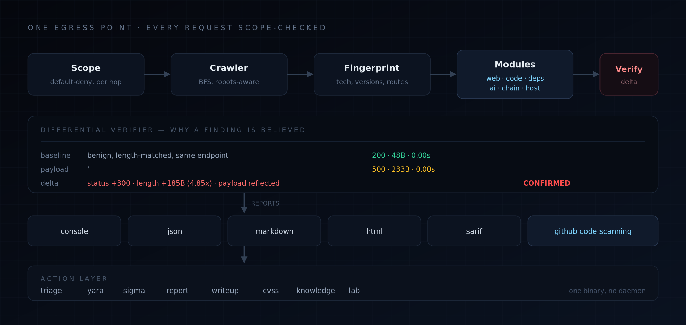

<p align="center">
  
</p>

<p align="center">
  
  
</p>

<p align="center">
  
  
  
  
</p>

<p align="center"><i>“Our business is life itself.”</i></p>

---

## The problem with scanners

Almost every scanner answers a question nobody asked: **“did a pattern match?”**

You get a list of template hits, a severity colour, and no way to tell the one real SQL
injection from the two hundred false positives. Then you spend the afternoon triaging —
which was the work the tool was supposed to do.

**nemesis answers a different question: *“did the server’s behaviour change when I
attacked it?”***

Every active check is a **differential experiment**. It sends a benign request, sends a
payload request to the *same* endpoint, and compares the two responses — status, body
length, timing, headers, and where the payload came back. A finding is only as strong as
the evidence that something changed.

That is why every active finding carries a **proof you can read**:

```
  CRITICAL  SQL injection in parameter 'q'
  target    http://127.0.0.1:8899/search
╭──────────────────────────────────────────────────────────────────────────╮
│ Baseline: 200 GET /search?q=x   (48B, 0.00s)                             │
│ Payload : '                                                              │
│ Probe   : 500 GET /search?q=%27 (233B, 0.00s)                            │
│ Delta   : status +300 · length +185 bytes (4.85x) · payload reflected    │
│ Verdict : CONFIRMED — the server changed behaviour and echoed the input  │
╰──────────────────────────────────────────────────────────────────────────╯
```

You do not have to trust the scanner. **You can read the experiment.**

This matters more than ever in 2026. AI-assisted fuzzing has made *volume* cheap and
*validity* expensive — which is why bug-bounty programmes are drowning in reports that
match a pattern and prove nothing. A scanner that shows its work is the only kind that
survives that.

---

## Why this is different

|  | nuclei | Burp Suite | Trivy / Grype | **nemesis** |
|---|---|:---:|:---:|:---:|
| Unit of work | template match | manual request | CVE match | **differential experiment** |
| Severity **and** confidence | severity only | human judgement | severity only | **two independent axes** |
| Proof of exploitability | — | manual | — | **on every active finding** |
| Whole-site crawl + active testing | optional | manual | — | **default** |
| Source analysis (SAST) | — | — | — | **secrets, logic bugs, patch diff** |
| Dependency analysis (SCA) | — | — | yes | **OSV-backed, local CVSS** |
| Detection content (YARA / Sigma) | — | — | — | **generated from findings** |
| Host posture (TLS, DNS, IPv6, proxy) | — | — | — | **yes** |
| Hosted bug-bounty report format | — | — | — | **HackerOne / Bugcrowd / Intigriti** |
| Needs a browser / daemon / Docker | no | yes | no | **no — a Python install** |
| Runs offline (except OSV lookups) | partial | no | yes | **yes** |

### The two-axis model

Most tools collapse severity and confidence into one number. That is how scanners lose
people’s trust.

- **Severity** answers *“how bad is this if it is real?”*
- **Confidence** answers *“how sure are you that it is real?”*

A critical finding with *medium* confidence is a completely different thing from a
critical finding that was confirmed by reading `/etc/passwd` back out of the response.
nemesis keeps them separate, and `nemesis triage` ranks on a third axis too: **effort to
confirm and fix.**

---

## Install

nemesis is not on PyPI yet. Install from source:

```bash
git clone https://github.com/HexVandal/nemesis
cd nemesis
python -m pip install -e ".[dev]"
```

**Requirements:** Python 3.10+. No browser, no daemon, no Docker, no API keys.
It runs on your machine and talks only to the target you name — plus `api.osv.dev`
when it resolves dependency advisories, which only happens on a dependency scan.

---

## Use it

```bash
# Scan an entire site
nemesis scan https://app.example.com

# Web application + local source tree + dependencies, together
nemesis scan https://app.example.com --code-path . --profile full

# Machine-readable, filtered with jq
nemesis scan https://app.example.com --json \
  | jq '.findings[] | select(.severity=="CRITICAL")'

# Findings into GitHub code scanning with no glue code
nemesis scan https://app.example.com --format sarif --output ./results
```

### Profiles

| Profile | What it does |
|---|---|
| `quick` | Passive checks plus the highest-signal active probes. Seconds. |
| `web` | Full web application assessment. Everything that speaks HTTP. |
| `code` | Static analysis and supply-chain review of a local checkout. |
| `ai` | AI and LLM application security: endpoints, prompt injection, agent tools, models. |
| `blockchain` | Smart contract auditing of a local Solidity tree. |
| `forensics` | Memory images, crash dumps and packet captures. |
| `recon` | Passive and low-impact discovery. No exploitation. |
| `full` | Everything: web, host, source and dependency layers. |
| `passive` | No requests beyond the crawl. Zero noise. |

### Output formats

`console` · `json` · `markdown` · `html` · `sarif`

SARIF 2.1.0 output means findings land in **GitHub code scanning** with no glue code,
which is how security stops being a separate ritual.

---

## From findings to something you can act on

A scan produces findings. These commands turn them into the things that actually get
used: a worklist, a detection rule, a disclosure report, a write-up.

```bash
# What do I do first, and why? Duplicates collapse into root causes.
nemesis triage results/nemesis.json

# Detection content, generated from what was actually observed.
nemesis yara  results/nemesis.json -o rules.yar
nemesis sigma results/nemesis.json -o rules.yml

# A bug-bounty report in the shape the programme actually triages.
nemesis report results/nemesis.json --programme hackerone --asset https://app.example.com

# A public write-up draft, with the limits of the review stated.
nemesis writeup results/nemesis.json --author "you"

# Score a CVSS vector and see what each metric does.
nemesis cvss "CVSS:3.1/AV:N/AC:L/PR:N/UI:N/S:U/C:H/I:H/A:H"
```

`nemesis triage` is the command that changes how a report is read:

```
== ACT NOW ==
  [0.93] CRITICAL (confirmed) SQL injection in parameter 'q'
          - impact 1.00 from severity CRITICAL
          - confidence confirmed contributes 1.00
  [0.89] CRITICAL (high     ) Exposed file: /.env
          - collapses 2 duplicate finding(s) of the same weakness
  [0.76] HIGH     (confirmed) Path traversal in parameter 'file'
  [0.74] HIGH     (confirmed) Reflected XSS in parameter 'id'
          - collapses 3 duplicate finding(s) of the same weakness

== SCHEDULE ==
  [0.62] HIGH     (medium   ) Possible IDOR on parameter 'id'
  [0.52] MEDIUM   (confirmed) Open redirect in parameter 'next'
```

Every rank states its inputs. A proven, reflected payload outranks a status-code change,
and the report says why.

---

## What it finds

**Web application** — SQL injection (error-based, UNION, time-based blind), NoSQL
injection, command injection, SSTI, XSS, XXE, insecure deserialization, path traversal,
SSRF, open redirect, IDOR, CSRF, host-header injection, GraphQL introspection, exposed
files, directory listing, stack traces, security headers, cookie flags, CORS
misconfiguration, clickjacking, mixed content, outdated technology, unsafe HTTP methods.

**Request-level** — CL.TE and TE.CL request smuggling, web cache poisoning, WebSocket
origin validation, file-upload handling, business-logic tampering of
price/quantity/role/state, and a real Content-Security-Policy parser that reports what the
policy *actually permits* rather than whether the header exists.

**Source code** — hardcoded secrets (AWS, GCP, GitHub, GitLab, Slack, Stripe, private
keys, JWTs, database URLs), command injection, `eval`, deserialisation, unsafe YAML, path
traversal, weak crypto, privilege-escalation patterns, and **logic bugs**: mutable default
arguments, swallowed exceptions, float arithmetic on money, `== None`, unvalidated
`assert` on production paths, off-by-one slices.

**Patch regression** — compares the working tree against `HEAD~1` and reports the
dangerous patterns a change *introduced* or *resurrected*. This is the check that stops a
fix from being quietly undone.

**Git history** — walks every revision and finds credentials that were committed and then
removed. Deleting a secret from `HEAD` does not remove it from every clone, fork or CI
cache that ever checked it out.

**Containers** — Dockerfiles, Compose files and Kubernetes manifests for the settings that
turn a container into an escape: the Docker socket mounted in, `privileged: true`, a root
user, a host namespace, an added capability.

**Network evidence** — parses pcap and pcapng directly, with no external dependency:
cleartext credentials, DNS exfiltration in a long encoded label, plaintext protocols
carrying sensitive traffic, and a bulk flow to a port nobody expected.

**Memory forensics** — parses memory images and crash dumps directly: process inventory,
command lines, the network connection table, persistence keys, regions that exist in
memory but not on disk, and secrets that were resident when the machine was seized.

**DeFi mechanics** — unchecked ERC-20 transfers, swaps with no `amountOutMin`, oracle reads
with no staleness or round check, AMM pricing from the pool’s own reserves, reachable token
callbacks, state changes with no event.

**Browser posture** — headers as a set rather than one at a time: a CSP permitting
`unsafe-inline` / `unsafe-eval` / `data:`, an HSTS `max-age` under a year, a `__Host-` cookie
breaking its own rules, missing cross-origin isolation.

**Fuzzing** — finds functions that take a byte buffer, generates a libFuzzer harness for
each, works out the build system, writes a seed dictionary. A harness that only exists in a
report is a harness nobody compiles, so this one is written to disk.

**Proxy and IPv6** — whether the app takes the client address, original host and scheme from
headers any client can set, and whether an address filter that accepts `127.0.0.1` also
accepts `::ffff:127.0.0.1`.

**Supply chain** — dependency confusion and typosquatting, CI/CD pipeline security
(`pull_request_target` with untrusted checkout, unpinned actions, expression injection into
`run:`, privileged containers, self-hosted runners), and IaC for Terraform, Kubernetes,
Dockerfiles and CloudFormation.

**Binaries** — a real ELF / PE / Mach-O parser: architecture, hardening posture (NX, PIE,
RELRO, stack canary), dangerous imports, packer detection, embedded credentials.
Extensionless executables are found by magic bytes, because that is what ends up in a
container image.

**AI and LLM** — model endpoint discovery and provider identification, prompt injection
(gated on real evidence a model is present, so it does not degenerate into a second XSS
scanner), model extraction and system-prompt leakage, agent tool-listing exposure, and
unsafe `torch.load` / `pickle.load`, PII in datasets, credentials in model cards.

**Smart contracts** — reentrancy, missing access control, `tx.origin` authorisation,
unchecked return values, unprotected initialisers, `ecrecover` without a zero-address check,
block-timestamp dependence.

**Dependencies** — PyPI, npm, crates.io, Go, Maven, RubyGems and Packagist manifests and
lockfiles, resolved against the live **OSV.dev** database, with CVSS scored locally.
Advisories group per package, not per CVE, so one outdated Django release is one finding and
not seventy-five.

**Host posture** — legacy TLS, expired certificates, weak ciphers, missing SPF / DMARC /
CAA, dangling CNAMEs.

---

## All 64 modules

Every module is a class, addressable by its id. List them with `nemesis modules`,
inspect one with `nemesis modules --detailed`, or run a subset with
`nemesis scan <target> -i sqli,xss,idor`.

### Injection — 7

| id | Name |
|---|---|
| `sqli` | SQL Injection |
| `nosql_injection` | NoSQL Injection |
| `command_injection` | OS Command Injection |
| `template_injection` | Server-Side Template Injection |
| `xss` | Reflected Cross-Site Scripting |
| `xml_external_entity` | XML External Entity (XXE) Injection |
| `insecure_deserialization` | Insecure Deserialization |

### Headers and browser — 9

| id | Name |
|---|---|
| `headers_security` | Missing Security Headers |
| `csp_analyzer` | Content Security Policy Analysis |
| `cookie_flags` | Cookie Missing Security Attributes |
| `cors_misconfig` | Permissive CORS Policy |
| `clickjacking` | Missing Clickjacking Protection |
| `mixed_content` | Mixed Content |
| `browser_security` | Browser Security |
| `proxy_security` | Proxy Trust and Header Confusion |
| `ipv6_security` | IPv6 Security |

### Authentication and access — 4

| id | Name |
|---|---|
| `csrf_missing` | Missing CSRF Protection |
| `idor` | Insecure Direct Object Reference |
| `open_redirect` | Open Redirect |
| `host_header_injection` | Host Header Injection |

### Exposure and disclosure — 3

| id | Name |
|---|---|
| `exposed_files` | Exposed Sensitive Files |
| `graphql_introspection` | GraphQL Introspection Enabled |
| `info_disclosure` | Information Disclosure |

### Traversal and upload — 3

| id | Name |
|---|---|
| `path_traversal` | Path Traversal / Local File Inclusion |
| `directory_listing` | Directory Listing Enabled |
| `file_upload` | File Upload Vulnerabilities |

### Request-level — 3

| id | Name |
|---|---|
| `request_smuggling` | HTTP Request Smuggling |
| `web_cache_poisoning` | Web Cache Poisoning |
| `websocket_security` | WebSocket Security |

### Business logic — 1

| id | Name |
|---|---|
| `business_logic` | Business Logic Vulnerabilities |

### SSRF and cloud — 2

| id | Name |
|---|---|
| `ssrf` | Server-Side Request Forgery |
| `cloud_attack_surface` | Cloud Attack Surface |

### HTTP methods — 1

| id | Name |
|---|---|
| `http_method_probe` | Permissive HTTP Methods |

### Source code — 13

| id | Name |
|---|---|
| `secrets` | Hardcoded Secrets |
| `git_history_secrets` | Git History Secrets |
| `dangerous_patterns` | Dangerous Code Patterns |
| `logic_bugs` | Correctness Bugs |
| `crypto_misuse` | Cryptographic Misuse |
| `patch_regression` | Patch Regression Detection |
| `privilege_escalation` | Privilege Escalation Primitives |
| `sandbox_escape` | Sandbox Escape Detection |
| `iac_misconfiguration` | Infrastructure as Code Misconfiguration |
| `binary_triage` | Binary Triage |
| `binary_exploit_primitives` | Binary Exploit Primitives |
| `fuzzing_readiness` | Fuzzing Readiness |
| `fuzz_harness` | Fuzzing Harness Generation |

### Dependencies — 4

| id | Name |
|---|---|
| `dependency_vulnerabilities` | Vulnerable Dependencies |
| `dependency_confusion` | Dependency Confusion |
| `typosquatting` | Typosquatting Detection |
| `license_risk` | Licence Risk |

### Supply chain — 2

| id | Name |
|---|---|
| `cicd_pipeline_security` | CI/CD Pipeline Security |
| `tech_outdated` | Outdated Component Version |

### AI and LLM — 5

| id | Name |
|---|---|
| `llm_endpoint_detection` | LLM Endpoint Detection |
| `prompt_injection` | Prompt Injection |
| `agent_tool_security` | Agent Tool Security |
| `model_extraction` | Model Extraction and Privacy |
| `ml_model_security` | ML Model Security |

### Blockchain — 2

| id | Name |
|---|---|
| `solidity_audit` | Solidity Smart Contract Audit |
| `defi_security` | DeFi Security |

### Forensics — 2

| id | Name |
|---|---|
| `memory_forensics` | Memory Forensics |
| `memory_dump_triage` | Memory Dump Triage |

### Host and network — 3

| id | Name |
|---|---|
| `dns_posture` | DNS Posture |
| `tls_configuration` | TLS Configuration Weakness |
| `pcap_analysis` | Network Traffic Analysis |

---

## Architecture

<p align="center">
  
</p>

```
                    ┌──────────────┐
   nemesis scan ───▶│    Scope     │  default-deny, every request checked
                    └──────┬───────┘
                           ▼
                    ┌──────────────┐
                    │   Crawler    │  BFS, robots-aware, scope-enforced
                    └──────┬───────┘
                           ▼
                    ┌──────────────┐
                    │ Fingerprint  │  tech, versions, frameworks
                    └──────┬───────┘
                           ▼
        ┌──────────────────────────────────────────┐
        │                 Modules                   │
        │  web/ · code/ · deps/ · ai/ · blockchain/ │
        │  supplychain/ · infra/ · plugins/         │
        └──────────────────┬───────────────────────┘
                           ▼
                    ┌──────────────┐
                    │  Verifier    │  differential analysis → confidence
                    └──────┬───────┘
                           ▼
                    ┌──────────────┐
                    │   Reports    │  console · json · md · html · sarif
                    └──────┬───────┘
                           ▼
        ┌──────────────────────────────────────────┐
        │        Action layer (CLI)                │
        │  triage · yara · sigma · report · writeup │
        └──────────────────────────────────────────┘
```

### Design commitments

- **Default-deny scope.** No request leaves the process without passing a scope check.
  Redirects are followed manually and re-checked at every hop, because a redirect is the
  classic way to smuggle a request out of scope.
- **One egress point.** Every request goes through a single client that owns rate limiting,
  redirect handling, timeouts and secret redaction. There is no second path.
- **Length-matched baselines.** A baseline uses a benign value of the *same length* as the
  payload. Without this, a one-character payload looks like a huge behavioural change simply
  because the echoed value got shorter — and the scanner reports an injection on every
  parameter it touches.
- **Severity and confidence are orthogonal.** Neither is ever derived from the other.
- **Secrets are redacted** from evidence before it reaches a report.
- **Destructive modules are opt-in** via `--allow-destructive`.
- **Polite by default.** 10 requests/second per host, configurable with `--rate`. A large
  site takes minutes, not because the tool is slow but because hammering someone’s
  production server is not a feature.

---

## The capability map: 102 areas, and an honest label on each

nemesis tracks **102 capability areas** — from kernel exploitation to security portfolio —
and says plainly which of them it actually does.

```bash
nemesis capabilities              # the whole map
nemesis capabilities --domain ai  # one domain
nemesis capability request-smuggling
```

| Maturity | Meaning | Count |
|---|---|---|
| `native` | nemesis does this itself, today. You can point at the module. | **32** |
| `partial` | nemesis covers a meaningful slice of it. | **40** |
| `integration` | nemesis produces or consumes the artifacts the work needs; a tool or a human does the rest. | **14** |
| `research` | Needs specialised hardware, a custom toolchain or a lab. | **16** |
| `manual` | A practice rather than a tool: reviewing, writing, disclosing. | **0** |

The registry is **validated against the real module registry**: a module which does not exist is a *test failure*, not a documentation bug.

That honesty is the point. A tool that claims to do kernel exploitation and does not is
worse than a tool that says it does not. The 16 `research` areas need a bench, a
disassembler or a soldering iron — they are labelled `research` because that is true.

### Two components back the areas that are not scans

- **`nemesis knowledge`** — a curated index of **186** real papers, books, courses, labs,
  standards and tools across **104** areas, with the reason each one is worth your time.
  Every URL is checked; the ones that rot get replaced.
- **`nemesis lab`** — a research workspace on disk. Lab notes, unsolved vulnerabilities,
  original research and a portfolio, each with a structure that makes it useful six months
  later.

```bash
nemesis knowledge --search "buffer overflow"
nemesis knowledge --area fuzzing
nemesis lab init
nemesis lab note "Testing the PNG parser"
nemesis lab finding "A race condition in the cache"
```

---

## Writing a plugin

A module is a class. That is the whole plugin system.

```python
from nemesis.modules.base import Module, ScanContext
from nemesis.models import Capability, Category, Confidence, Finding, Severity


class MyCheck(Module):
    id = "my_check"
    name = "My Check"
    description = "Looks for something specific."
    severity = Severity.MEDIUM
    confidence = Confidence.HIGH
    category = Category.WEB
    capability = Capability.HTTP
    group = "web"
    tags = ["custom"]

    async def run(self, ctx: ScanContext) -> list[Finding]:
        findings = []
        for response in ctx.responses:
            if "x-secret-header" in response.headers:
                findings.append(self.finding(
                    title="Internal header exposed",
                    target=response.url,
                    description="The response contains an x-secret-header.",
                    evidence_text=str(dict(response.headers)),
                    matched="x-secret-header",
                ))
        return findings
```

Drop it in `nemesis/plugins/`, or publish it as a package that registers a
`nemesis_plugins` entry point, and it is picked up automatically. No registry to edit.

```bash
nemesis scan https://app.example.com --plugins ./my_checks/
nemesis modules --detailed
```

---

## Responsible use

nemesis sends real attack payloads. It is a tool for **authorised security testing**:
penetration tests, bug bounties, CTFs, internal red teams, and defensive audits of systems
you own.

**Do not point it at systems you do not have permission to test.** It will find real
vulnerabilities, and finding one on someone else’s system without authorisation is a legal
problem, not a technical one.

- Scope is default-deny and must be widened explicitly.
- `--allow-destructive` is required for anything that changes server state.
- Rate limiting is on by default, per host.
- Use `--profile passive` when you need reconnaissance without exploitation.
- Report a vulnerability in nemesis itself through the private advisory form:
  https://github.com/HexVandal/nemesis/security/advisories/new

---

## Contributing

Issues and pull requests are welcome. Start with [`CONTRIBUTING.md`](CONTRIBUTING.md) — it
explains the module contract and how to add a check without regressing the false-positive
rate.

```bash
python -m pip install -e ".[dev]"
pytest -q
ruff check nemesis tests
```

Current state: **277 tests**, ruff-clean, CI on Python 3.10–3.13.

---

## License

Apache-2.0. See [`LICENSE`](LICENSE).

<p align="center">

  <sub>Built for people who would rather read the experiment than trust the verdict.</sub>
</p>
